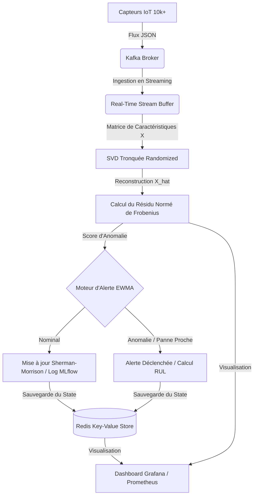

# 🔥 Plateforme Industrielle de Maintenance Prédictive (SVD) 🔥

Une plateforme de maintenance prédictive de pointe, hautement scalable, conçue pour ingérer le flux de données en temps réel de plus de **10 000 capteurs IoT**, détecter les anomalies mécaniques par décomposition en valeurs singulières (**SVD**), et anticiper les pannes avant qu'elles ne surviennent.

---

## 🧭 1. Architecture Générale du Système

Le système est construit sur une architecture de streaming distribuée de classe industrielle :



---

## 🧱 2. Structure Complète du Projet

Voici la structure de production mise en place et alignée sur vos exigences :

```
predictive-maintenance-svd/
│
├── src/
│   ├── ingestion/
│   │   ├── kafka_consumer.py       # Ingests raw data from Kafka / Realistic local simulator
│   │   └── stream_buffer.py        # Aligning IoT asynchronous streams into feature matrix X
│   │
│   ├── math/
│   │   ├── svd.py                  # Truncated standard SVD and fast Randomized SVD O(N log K)
│   │   ├── norms.py                # Matrix L2 and Frobenius norm computations
│   │   ├── condition_number.py     # Classifying numerical stability using cond = s_max / s_min
│   │   └── sherman_morrison.py     # Fast O(N^2) updates for dynamic sensor correlations
│   │
│   ├── anomaly/
│   │   ├── reconstruction.py       # Matrix low-rank reconstruction X_hat = U_k * diag(S_k) * V_k^T
│   │   ├── residual_score.py       # Raw and normalized Frobenius anomaly residuals
│   │   └── thresholding.py         # Static (Mean+3*Std) and Adaptive EWMA alerting
│   │
│   ├── pipeline/
│   │   ├── streaming_pipeline.py   # Orchestrator of the real-time SVD streaming pipeline
│   │   └── batch_pipeline.py       # Offline baseline configuration and static threshold training
│   │
│   ├── storage/
│   │   ├── redis_state.py          # Redis persistence for real-time states and alarm logs
│   │   └── mlflow_tracking.py      # Experiment and hyperparameter tracking (MLflow)
│   │
│   └── visualization/
│       └── dashboard_metrics.py    # Exposes scraping ports for Prometheus and renders terminal dashboards
│
├── configs/
│   └── config.yaml                 # System & Model hyperparameter configurations
│
├── tests/
│   ├── test_svd.py                 # Core unit tests for SVD & low-rank reconstruction
│   ├── test_stability.py           # Unit tests for condition numbers and Sherman-Morrison updates
│   └── test_stream.py              # Unit tests for Kafka consumers, stream buffering & interpolation
│
├── docker/
│   ├── kafka/                      # Readme and configs for Kafka brokers
│   ├── spark/                      # PySpark structured streaming memory & backpressure configs
│   └── app/                        # Dockerfile for compiling the streaming application container
│
├── docker-compose.yml              # Multi-container orchestration (Kafka, Redis, Prometheus, Grafana)
├── requirements.txt                # System packages and MLOps dependencies
└── README.md                       # Documentation and startup guidelines
```

---

## ⚙️ 3. Rigueur Mathématique & Formulations Réelles

### A. SVD Tronquée & Randomized SVD
Pour supporter 10 000+ capteurs sans saturation CPU, nous remplaçons le SVD standard $O(N^3)$ par la **Randomized SVD** $O(N^2 \log K)$ via `sklearn.utils.extmath.randomized_svd`.
Le choix du rang de troncature $k$ est géré dynamiquement par **seuil d'énergie de Frobenius** à $95\%$ :
$$\frac{\sum_{i=1}^k \sigma_i^2}{\sum_{j=1}^r \sigma_j^2} \ge 0.95$$

### B. Score d'Anomalie de Frobenius Normé
La déviation par rapport à l'état nominal est quantifiée par le résidu de reconstruction. Pour éliminer les biais d'amplitude de signal et les variations de gains des capteurs, nous appliquons une normalisation stricte :
$$\text{Score} = \frac{||X - \hat{X}||_F}{||X||_F}$$
où $X$ représente la matrice réelle des caractéristiques et $\hat{X} = U_k \Sigma_k V_k^T$ sa reconstruction de bas rang.

### C. Conditionnement Numérique
Pour garantir la stabilité du pipeline en production, le rapport de conditionnement est calculé à chaque pas de temps :
$$\text{cond}(X) = \frac{\sigma_{\max}}{\sigma_{\min}}$$
*   **$\text{cond}(X) < 100$** : État sain et stable (**STABLE**).
*   **$100 \le \text{cond}(X) \le 1000$** : Anomalie de colinéarité naissante, dérive de capteur (**MODERATE**).
*   **$\text{cond}(X) > 1000$** : Instabilité numérique majeure, risque de capteurs dupliqués ou déconnectés (**UNSTABLE**).

### D. Sherman-Morrison pour Capteurs Dynamiques
Lorsqu'un capteur dynamique est ajouté ou recalibré, l'inverse de la matrice de corrélation $A = X^T X$ est mis à jour instantanément en temps d'exécution $O(N^2)$ au lieu de $O(N^3)$ en appliquant la formule de **Sherman-Morrison** :
$$(A + u v^T)^{-1} = A^{-1} - \frac{A^{-1} u v^T A^{-1}}{1 + v^T A^{-1} u}$$

---

## 🚀 4. Guide de Démarrage et Validation

### A. Configuration de l'environnement virtuel
```powershell
python -m venv venv
.\venv\Scripts\activate
pip install -r requirements.txt
```

### B. Lancement des Services Docker (Kafka, Redis, Prometheus, Grafana)
```powershell
docker-compose up -d
```

### C. Étape 1 : Entraînement hors-ligne et Baseline (Batch Pipeline)
Calcule les limites statistiques nominales sur les jeux de données de référence (NASA Bearing / SECOM) :
```powershell
python src/pipeline/batch_pipeline.py
```
*Génère un fichier de configuration baseline dans `artifacts/svd_baseline_parameters.yaml`.*

### D. Étape 2 : Lancement du Pipeline en Streaming Temps Réel
Démarre la capture des capteurs IoT, le calcul SVD à la volée, le calcul d'alertes adaptatives et expose les scrapers pour Grafana :
```powershell
python src/pipeline/streaming_pipeline.py
```
*Le terminal affiche un dashboard ASCII ultra-complet indiquant le spectre de valeurs singulières, la dérive numérique, le conditionnement, et le niveau de risque.*

### E. Lancement des Tests Unitaires Mathématiques et Streaming
```powershell
pytest -v
```

---

## 🧠 5. Fonctionnalités de Robustesse Industrielle

1.  **Interpolation des Capteurs Perdus (NaN)** : Le `RealTimeStreamBuffer` interpole automatiquement par interpolation linéaire les capteurs tombés en panne pour empêcher le plantage des équations matricielles.
2.  **Gestion de la dérive (Drift)** : Le seuil d'anomalie EWMA s'adapte en continu à l'usure mécanique normale des pièces, évitant les fausses alertes à répétition.
3.  **Surveillance des Singularités** : La surveillance continue du conditionnement numérique permet de désactiver temporairement les canaux corrompus.
